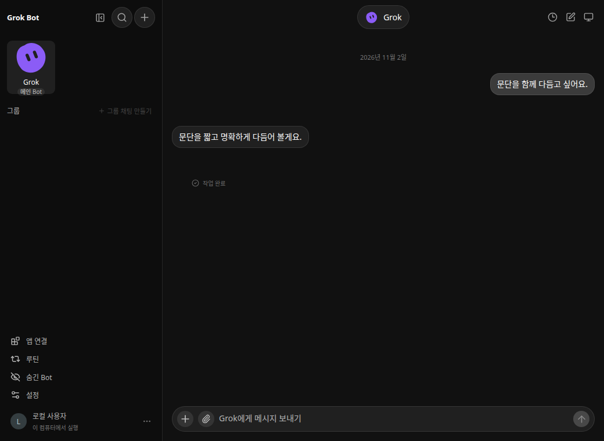
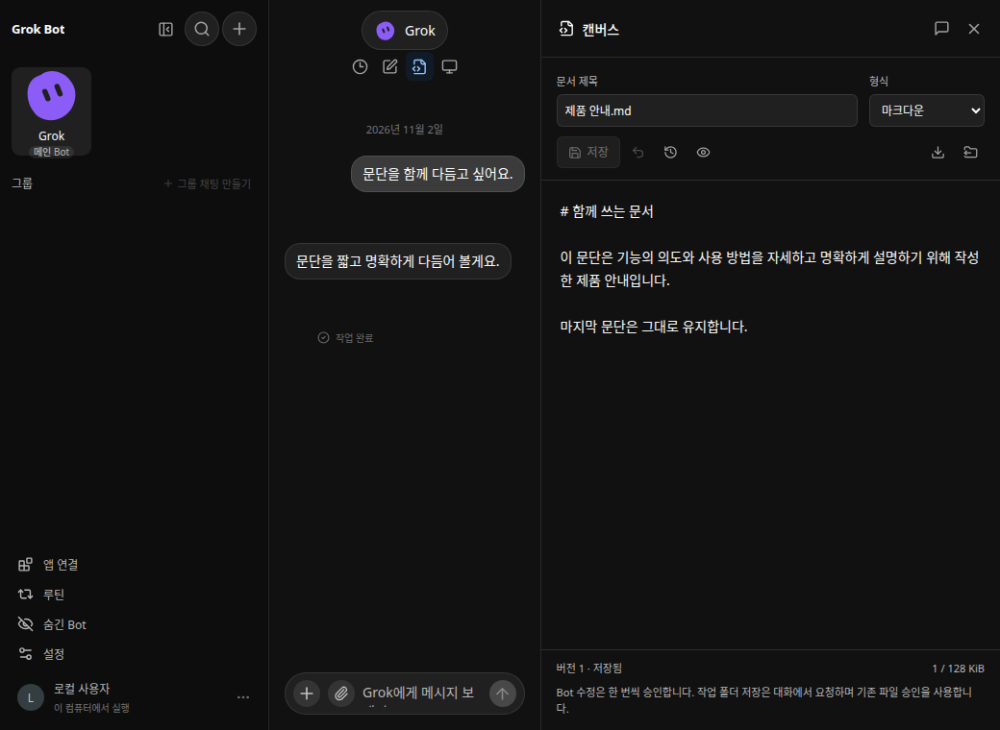
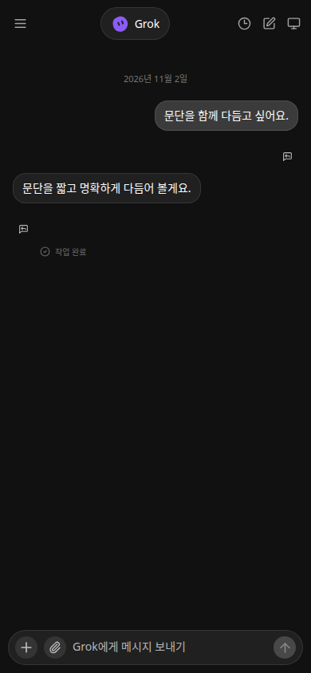
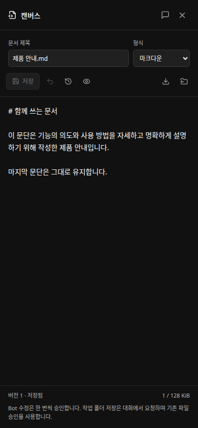
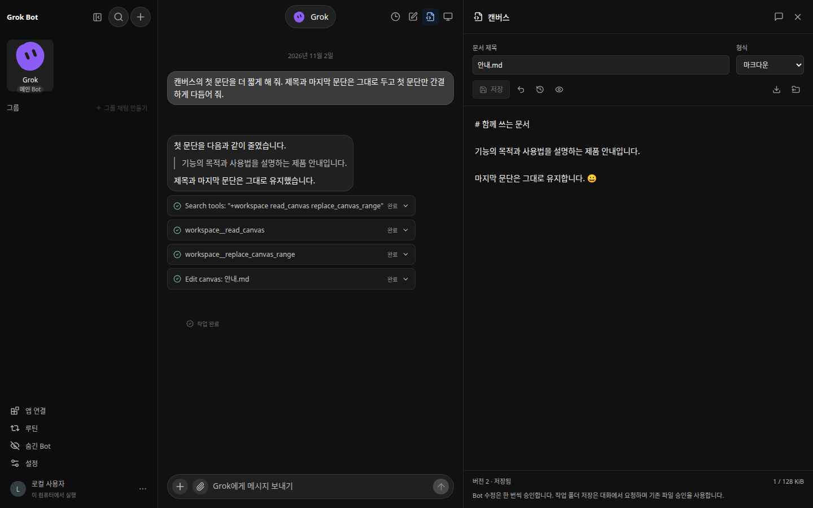

# Issue #19 — 캔버스 실제 앱 비교

모든 이미지는 실행한 앱의 Chrome 캡처입니다. 모형·원본 제품 이미지가 아니며 임시 데이터와 합성 문서만 사용했습니다. 공급자 주소·자격 증명·기존 사용자 대화는 포함하지 않습니다.

## Before / After

- **Before**: `95ffc46`의 실제 Node 앱. `git archive`로 분리한 변경 전 소스에서 실행했습니다.
- **After**: `conversation-canvas-04dddb772d1b` 브랜치의 구현 커밋 `4f350417699dd39580e13c69cd6d9c0001a9d0fd`. 뒤의 증거 전용 커밋은 실행 코드를 변경하지 않습니다.
- 공통 조건: Chrome, 어두운 테마, 같은 기본 Bot의 고정 모양·색상, 같은 합성 1회 대화, 같은 로컬 모의 공급자 응답. 데스크톱 **1040 × 760**, 모바일 **390 × 844**.
- 같은 대화에서 문서 편집을 시작하는 상황입니다. 변경 전에는 캔버스 진입점·편집 영역이 없고 대화만 표시됩니다. 변경 후에는 그 대화 옆에 저장된 합성 마크다운 문서를 표시합니다. 모바일은 캔버스가 전체 너비를 사용하며 대화로 돌아갈 수 있습니다.

### Desktop Before — `95ffc46`

### Desktop After — `4f35041`

### Mobile Before — `95ffc46`

### Mobile After — `4f35041`

## 실제 모델 부분 수정

별도의 임시 Rust 앱에서 자연어 “캔버스의 첫 문단을 더 짧게 해 줘. 제목과 마지막 문단은 그대로 두고 첫 문단만 간결하게 다듬어 줘.”를 전송했습니다. 요청에 도구 이름은 넣지 않았습니다. 실제 `gpt-6.1-sol`이 현재 버전을 읽고 부분 수정 승인을 요청했습니다.

- 승인 전 버전 1 원문 불변.
- 승인 후 버전 2, `source: bot`. 첫 문단만 더 짧아졌으며 제목·마지막 문단·이모지를 보존했습니다. 실제 축약 문구는 구조화된 결과에 기록합니다.
- 되돌리기 후 새 버전 3, `source: restore`, 원문과 정확히 같음.
- 브라우저 예외 없음. 모델 품질 일반화나 다회 성공률 측정은 아닙니다.

이 실제 모델 성공 기록은 2026-11-02 06:15 UTC의 커밋 전 작업 트리에서 관찰했습니다. 최종 검토 후에는 같은 시나리오의 실제 모델 재확인을 시도했으나 응답 대기 시간 초과와 실행 호스트 재시작으로 완료하지 못했으므로 최종 커밋의 실제 모델 재실행 성공을 주장하지 않습니다. 최종 커밋은 실제 앱 엔진·모의 공급자, 전체 관련 단위·통합 테스트와 브라우저 회귀로 확인했습니다. 기존 설정은 서버에서 공급자 연결에만 사용했고 기존 앱 데이터는 수정하지 않았습니다.

[구조화된 결과](actual-model.json)

