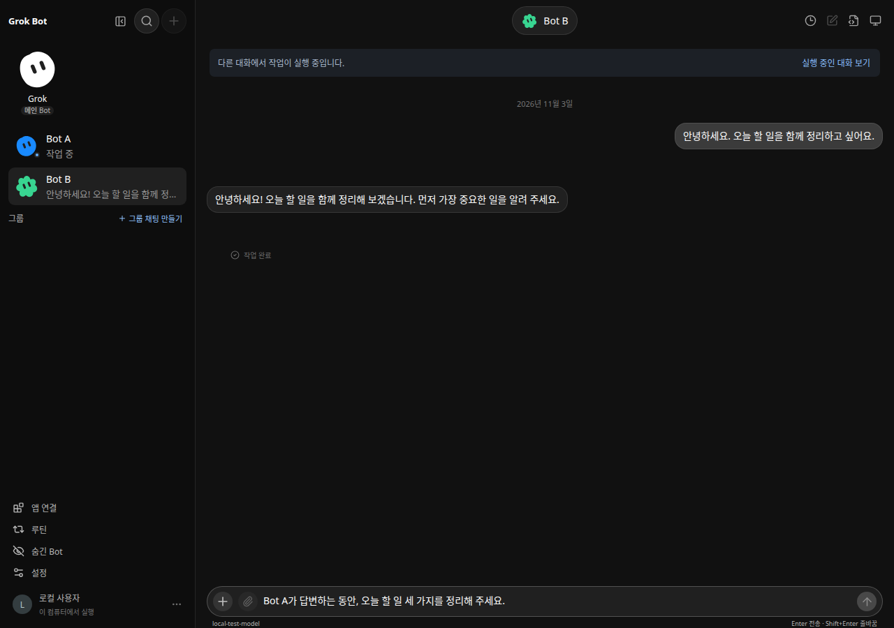
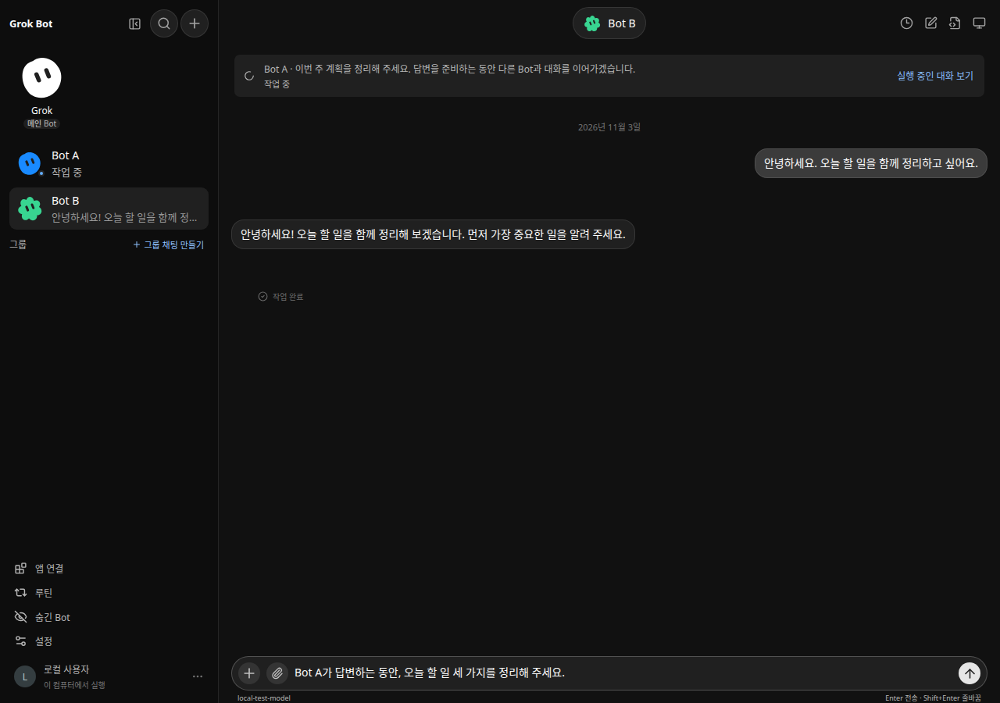

# Bot별 동시 대화 — 실제 Before / After

[이슈 #20](https://github.com/elicie/bot/issues/20)의 UI 단계 비교입니다. PNG는 실제 앱·브라우저·원본 엔진과 로컬 OpenAI 호환 공급자가 실행한 화면입니다. 모형 화면, API 가로채기, 가짜 실행 상태, 원본 이미지 합성은 사용하지 않았습니다.

## 리비전과 동일 조건

- **Before UI:** `e7de2f2d4f10539e0e25ee39752dd47e205c06ba`, `web` tree `1f77c3ee7dde90763ea4f2ffa3739843f8311e9a`. 별도 detached checkout에서 실제 원래 프론트엔드를 빌드했습니다. Core PR 1은 화면 코드를 바꾸지 않으므로 이 tree가 UI PR의 변경 전 화면입니다.
- **After UI:** `92ef3d9184b4e05406346f381cdb12f905322dc5`, `web` tree `62db3e9058c91520d8c50df1c1dc08469e7f0067`. 캡처 당시 프론트엔드 실행 소스는 clean 상태였고, 이후 test-only 병합/문서 추가는 이 화면 tree를 바꾸지 않습니다.
- **동일 backend binary:** Core `1cad678decf1187eda69fc37a2be8bc8a04de4dc`의 실제 빌드. SHA-256 `0bdb016272a900d0c811e7f52c40df1e30b741ec7090f98db80a58ea79f204ee`. After 시점의 core checkout `aa81ed0c711cfbad496784cbe85d03cf33c8c41e`는 테스트 통합/fixture import만 바뀌었으며 production core/model/store/engine tree가 동일함을 검사했습니다. 이 테스트 전용 이동 때문에 backend를 새로 만들었다고 주장하지 않습니다.
- **브라우저:** 실제 Google Chrome `150.0.7871.181`, scale factor 1, 한국어 `ko-KR`, `Asia/Seoul`, reduced motion.
- **Desktop:** 1280 × 900, dark theme, 기본 280px 펼친 사이드바.
- **Mobile:** 390 × 844, 같은 dark theme·같은 실행 상태에서 resize. 사이드바 닫힘/열림을 각각 비교했습니다.
- 실제 API로 기본 Grok와 동일한 Bot A(파랑/blob), Bot B(초록/flower)를 구성했습니다. Bot B의 첫 인사/응답을 완료한 뒤 Bot A의 실제 추론 응답을 공급자 promise로 잡아 둡니다. 그 상태에서 Bot B를 선택하고 **똑같은 전송 전 초안**을 입력합니다.

## Before / After — 같은 미전송 초안

Before에는 다른 Bot 실행으로 전송이 비활성화됩니다. After에는 A의 현재 작업을 알려 주되 B의 전송을 활성화합니다. 캡처 뒤 실제 전송까지 확인했으며 초안만 조작해 성공으로 보이지 않게 했습니다.

| 화면 | Before | After |
| --- | --- | --- |
| Desktop, 1280 × 900, dark | [Before](before-desktop.png) | [After](after-desktop.png) |
| Mobile, 390 × 844, dark | [Before](before-mobile.png) | [After](after-mobile.png) |
| Mobile sidebar, 390 × 844, dark | [Before](before-mobile-sidebar.png) | [After](after-mobile-sidebar.png) |

### Before — Desktop

### After — Desktop

## 추가 실행 증거

- [A와 B가 동시에 실제 추론 중](after-concurrent-desktop.png).
- B의 다음 사용자 요청이 현재 답변과 분리된 [Desktop 대기열](after-queued-desktop.png), [Mobile 대기열](after-queued-mobile.png), [Mobile 사이드바의 실행/대기 개수](after-queued-mobile-sidebar.png).
- [A는 계속 실행 중이고 B만 답변을 완료한 화면](after-b-replied-desktop.png).

대기 항목의 개별 취소 전후 A/B의 실제 run ID와 `running` 상태가 그대로임을 검사했습니다. 취소된 대기 텍스트는 공급자에 전달되지 않았습니다. 실제 동시 추론 2개, 기본 상한 3, 전송 활성화, 초안 보존, 가로 overflow 없음, 페이지/브라우저 오류 0을 검사했습니다. 별도 Playwright 스펙은 대화 Stop의 범위, 대기 복구, light theme, 독립 승인/거절과 실제 파일 결과도 확인합니다.

전체 state/provider 요청·로컬 경로와 실행 로그는 공개 증거에 복사하지 않습니다. raw provenance/checks/cleanup은 작업 디렉터리에 보존하고, 공개할 필요가 있는 revision·hash·조건·결과만 이 문서와 [검증 요약](verification.json)에 기록합니다. 각 캡처 후 앱·공급자·Chrome을 종료하고 임시 loopback 포트가 닫힌 것을 확인했습니다. 개인 대화, Feishu 내용, 실제 API key나 credential은 포함하지 않았습니다.
