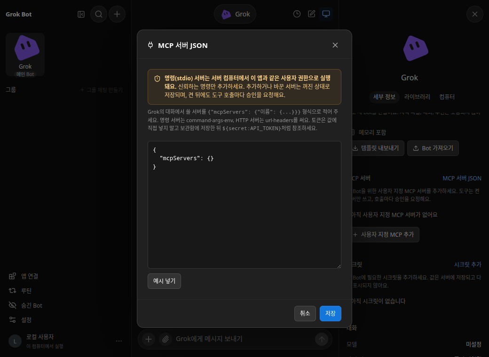
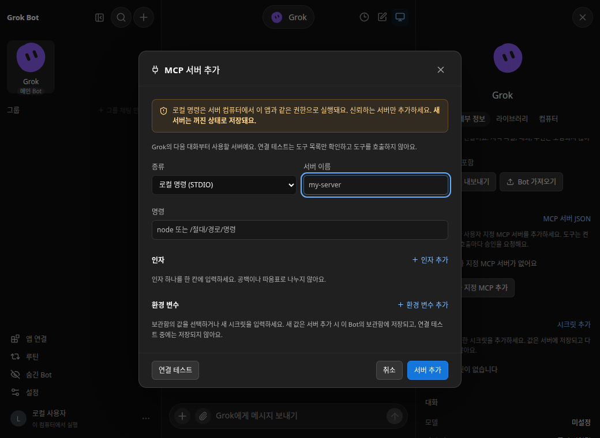
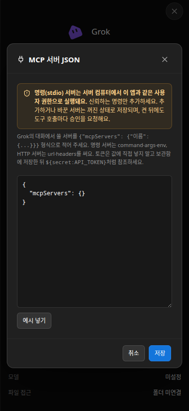
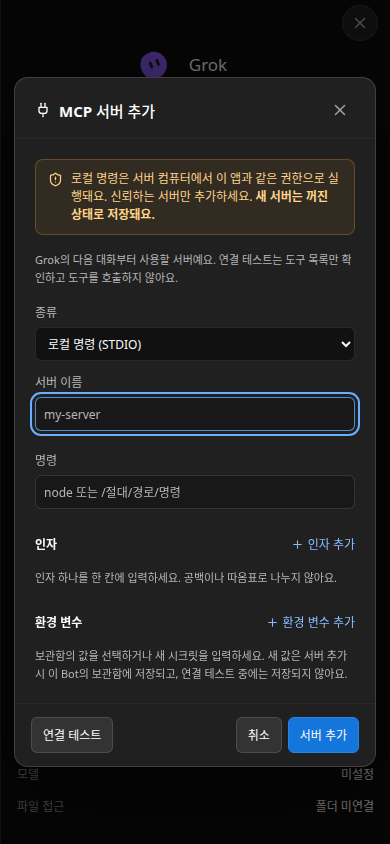
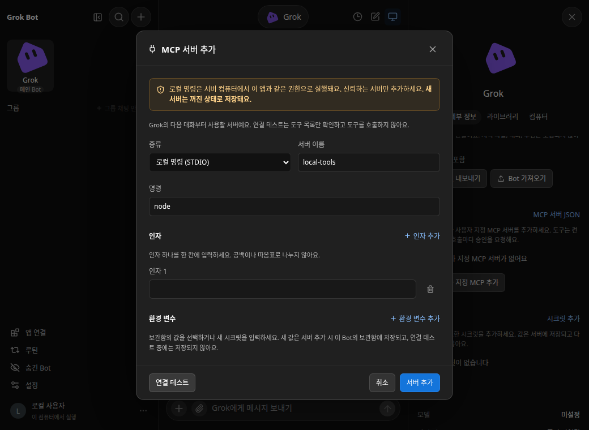
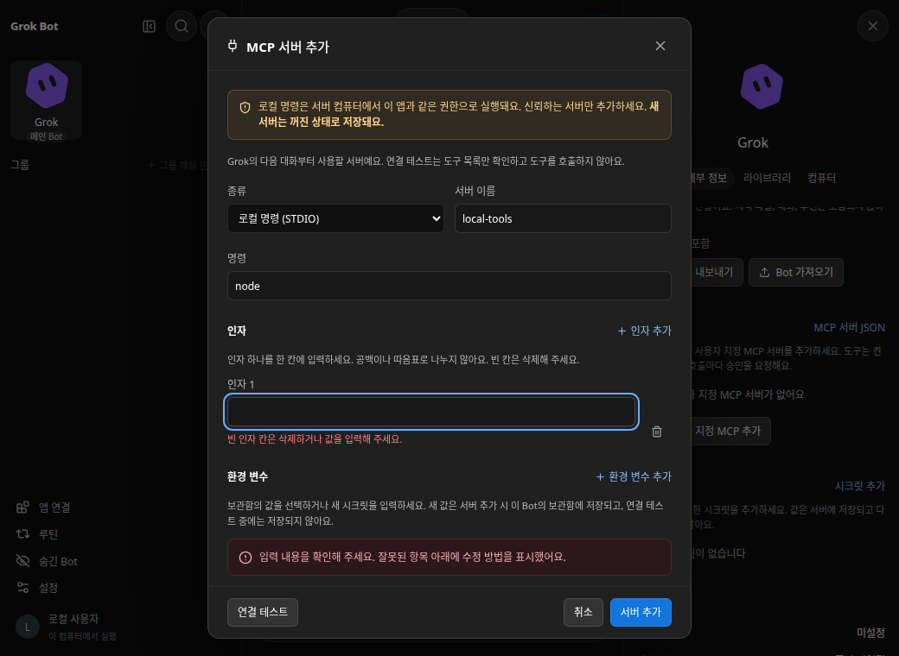
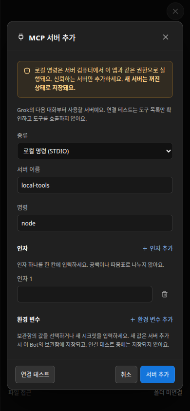
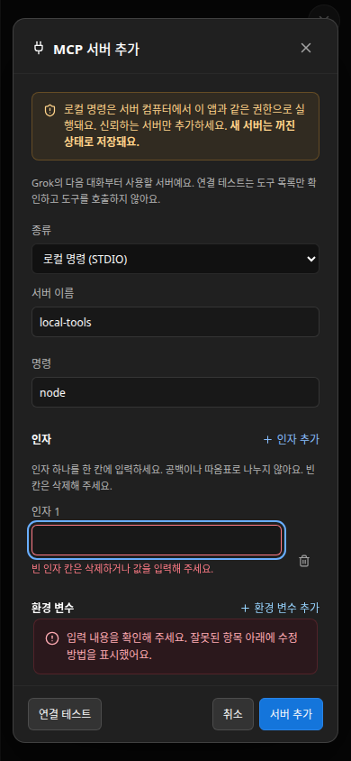

# MCP 서버 입력 폼

Rust 서버에서 Bot 세부 정보의 **사용자 지정 MCP 추가**로 서버를 하나씩 추가합니다. **MCP 서버 JSON**은 전체 구성을 편집하는 고급 화면으로 그대로 남아 있습니다.

## 사용 흐름

1. **로컬 명령 (STDIO)** 또는 **원격 URL (HTTP)**를 선택하고 서버 이름을 입력합니다.
2. 로컬 서버는 서버 컴퓨터의 PATH에서 찾을 명령 이름 또는 절대 경로와 인자를 입력합니다. 인자 하나가 입력 칸 하나이며, 공백·따옴표로 다시 나누거나 셸로 실행하지 않습니다. 원격 서버는 Streamable HTTP URL을 입력합니다.
3. 환경 변수/헤더를 추가하고 보관함의 시크릿을 선택합니다. Bot별 시크릿이 같은 이름의 모든 Bot용 시크릿보다 우선합니다. **직접 입력 → 새 시크릿**은 새 이름과 쓰기 전용 값을 입력하는 방식입니다. HTTP의 `Bearer ` 같은 접두사는 토큰과 분리해 입력하며 끝의 공백을 포함해 그대로 붙습니다.
4. **연결 테스트**는 저장하지 않은 현재 입력으로 초기화하고 도구 목록을 확인합니다. 로컬 명령 테스트는 실제 명령을 실행하므로 한 번 더 확인합니다. 테스트는 모델이나 도구를 호출하지 않고 시크릿·서버를 저장하지 않습니다.
5. **서버 추가**는 새 값을 Bot별 보관함 시크릿으로 서버 구성과 함께 저장하고 환경 변수/헤더에는 `${secret:이름}` 참조만 기록합니다. 새 서버는 꺼진 상태로 목록에 나타납니다. 켠 뒤 대화에서 도구를 사용하면 기존 승인 정책을 따릅니다.

연결 테스트의 성공은 현재 연결·도구 조회가 가능하다는 뜻이며, 이후의 모든 도구 실행이나 서버의 안전성을 보증하지 않습니다. 연결 테스트 없이도 서버를 추가할 수 있습니다.

## 저장과 JSON 화면의 일관성

두 화면 모두 기존 `PUT /api/bots/:botId/mcp-servers` API를 사용합니다. 기존 `{ "json": "…" }` 요청은 그대로 지원하고, 폼은 선택적인 `secrets` 목록으로 새 시크릿을 함께 전달합니다. 폼은 저장 직전에 최신 `GET` 문서에 서버를 추가해 다른 항목을 보존합니다. 기존 서버의 이름·구성이 같으면 ID와 켜짐 상태를 유지하며, JSON에서 변경한 서버는 기존 정책대로 꺼집니다.

기존 전체 문서 API에는 revision/ETag 조건이 없으므로 마지막 GET과 PUT 사이에 다른 창이 저장하는 경쟁까지 원자적으로 차단하지는 않습니다. 두 화면의 저장 형식이나 서버 레코드를 별도로 만들지 않습니다.

폼의 시크릿과 서버 구성은 하나의 저장 작업으로 적용합니다. 잘못된 구성·중복 이름·시크릿 검증 오류가 있으면 둘 다 적용하지 않으며, 부분 저장된 시크릿도 남기지 않습니다. 폼은 입력을 유지하므로 오류를 수정하거나 다시 시도할 수 있습니다. 새 시크릿은 현재 Bot 범위이고 전달한 구성에서 참조해야 합니다. 별도 보관함 화면에서 직접 만든 시크릿은 이 일괄 저장과 무관합니다.

## 검증과 기존 제한

- 이름: 소문자·숫자로 시작하는 32자 이하 `a-z`, `0-9`, `-`, `_`. `__`와 `workspace`로 시작하는 이름 및 기존 이름은 거절합니다. Bot당 최대 10개입니다.
- 명령: 비어 있지 않은 1,024자 이하의 실행 파일 이름/절대 경로. 인자는 최대 64개, 각각 4,096자 이하입니다. 폼과 연결 테스트에서는 비어 있거나 공백뿐인 인자를 거절하며 빈 칸은 삭제해야 합니다. 기존 JSON 편집기의 의도적인 빈 문자열 인자는 호환성을 위해 유지합니다.
- URL: HTTP/HTTPS, 최대 2,048자, 사용자명·비밀번호·fragment 없음. 인증 값은 헤더에서 설정합니다.
- 환경 변수/헤더: 각각 최대 64개. HTTP 헤더 중복은 대소문자를 구분하지 않습니다.
- 새 시크릿: 대문자 영문으로 시작하는 `A-Z`, `0-9`, `_` 이름 64자 이하. 기존 이름은 선택해야 하며 폼이 기존 값을 덮어쓰지 않습니다. 값은 기존 보관함 정책대로 앞뒤 공백을 제거하고 8~8,192자, 제어 문자 없이 저장합니다. 따라서 짧은 일반 설정 값도 이 폼에서는 직접 시크릿으로 저장할 수 없습니다. 필요한 비밀이 아닌 짧은 리터럴은 기존 JSON 편집기를 사용합니다.
- MCP 문서는 최대 64 KiB입니다. 최종 검증은 서버가 담당하며, 실패 시 입력과 오류를 유지합니다.
- 실행 중에는 서버 추가와 테스트를 막고 입력을 유지합니다. 연결 테스트는 전체 초기화·도구 조회에 10초, 응답 크기와 도구 목록 페이지에도 상한을 둡니다.
- 보관함의 기존 저장 방식(서버 계정 전용 `state.json`, 별도 암호화/OS 키체인 없음)은 변경하지 않습니다.

## 연결 테스트 API

**저장 없는** 보조 API입니다. 앱 명령 큐에서는 실행 중인 답변 확인과 초안 해석만 수행하고 네트워크·프로세스 실행은 큐 밖에서 추적합니다. 동시에 하나만 테스트할 수 있으며 추가 요청은 대기열에 쌓지 않고 즉시 `429`를 반환합니다. 연결 테스트 중에도 메시지 전송·승인·설정·루틴 등의 쓰기 요청은 진행됩니다.

```http
POST /api/bots/:botId/mcp-servers/test
Content-Type: application/json
X-Grok-Bot: 1
```

```json
{
  "json": "{\"mcpServers\":{\"sample\":{\"url\":\"https://example.com/mcp\",\"headers\":{\"Authorization\":\"Bearer ${secret:API_TOKEN}\"}}}}",
  "secrets": [
    { "name": "API_TOKEN", "value": "example-only-token", "botId": "현재 Bot ID" }
  ]
}
```

`json`에는 서버가 정확히 하나 있어야 합니다. 선택적인 `secrets`는 테스트 동안만 존재하며 `botId` 생략 시에도 현재 Bot 범위입니다. 다른 Bot 범위, 중복 이름, 기존 Bot별 시크릿 덮어쓰기는 거절합니다. 기존 보관함과 같은 값/이름 검증과 참조 해석을 공유합니다. 성공은 `200 {"toolCount": 1}`입니다. 원격 서버가 돌려준 본문·자격 증명·표준 오류를 API 오류나 로그로 노출하지 않고 범주별 오류를 반환합니다. 프로브의 HTTP 리디렉션은 따르지 않습니다. STDIO 프로세스는 성공·오류·시간 초과·실제 브라우저 TCP 연결 종료 시 정리합니다. 앱 종료 시에는 새 테스트를 차단하고 추적 중인 테스트가 자식 프로세스를 회수할 때까지 기다립니다. 큐와 무관하게 추적하므로 연결이 먼저 끊긴 테스트도 종료 처리에 포함합니다.

명령 테스트는 실제 엔진과 같은 서버 프로세스 환경·작업 폴더를 명시적으로 캡처하고 구성의 환경 변수와 별도의 `GROK_SESSION_ID`를 적용합니다. 테스트를 위해 임의의 HOME·PATH·작업 폴더를 가정하지 않습니다. 이는 실행 환경의 일치이지 비밀 환경 변수를 격리하는 샌드박스가 아닙니다. 정상 종료에서는 Unix 프로세스 그룹과 직접 자식을 정리하지만, 서버 자체를 SIGKILL하거나 명령이 `setsid`로 그룹을 탈출하는 경우까지 보장하는 OS 작업 격리는 이 변경에 포함하지 않습니다.

기존과 같이 실제 TCP 연결이 localhost인 클라이언트만 원문 읽기·저장·테스트·켜기와 시크릿 변경을 할 수 있습니다. LAN에서는 새 폼 진입도 비활성화하고 API도 거절합니다. **LAN에서 이미 켜진 서버를 끄는 안전 축소 동작은 기존대로 허용합니다.**

## 초기 폼 추가의 시각 기록 (#30)

실제 앱의 빈 Bot에서 **사용자 지정 MCP 추가**를 연 같은 시나리오입니다. 다크 테마, 데스크톱 1040×760 / 모바일 390×844입니다. 이 표는 초기 폼 추가의 기록이며 Before는 `95ffc464e8d55c1a315fddb31101fadb9c9c5b7b`, After는 `79378762c35faf381382bf63a2a1d23af80c13fe`입니다.

| | Before: JSON 입력만 제공 | After: 서버별 입력 폼 |
|---|---|---|
| 데스크톱 |  |  |
| 모바일 |  |  |

## 연결 테스트 후속 검증의 시각 비교 (#34)

실제 앱에서 이름 `local-tools`, 명령 `node`, 빈 인자 한 칸을 입력하고 **연결 테스트**를 누른 동일한 시나리오입니다. 다크 테마, 데스크톱 1040×760 / 모바일 390×844입니다. Before는 병합 기준 `d6c90d6698a890667a5edbbc3f898b53e26b09bc`, After의 변경 리비전은 후속 PR 설명에 기록합니다. Before는 실행 확인을 취소하면 오류 없이 빈 칸이 남고, After는 실행 전에 해당 인자로 포커스를 옮겨 수정 방법을 표시합니다.

| | Before — 빈 인자를 허용 | After — 해당 입력에서 차단 |
|---|---|---|
| 데스크톱 |  |  |
| 모바일 |  |  |

## 검증 범위

폼 검증/직렬화 단위 테스트, Rust 보관함/HTTP 프로브 테스트, 실제 Rust 앱과 로컬 MCP·모델 fixture를 사용하는 브라우저 시나리오로 확인합니다. 브라우저 시나리오는 입력 → 저장 전 연결 → 목록 → 서버 켜기 → 도구 승인 → 실행을 포함합니다. 실제 외부 서비스의 인증·연결 호환성은 해당 서버에서 별도로 확인해야 합니다.
